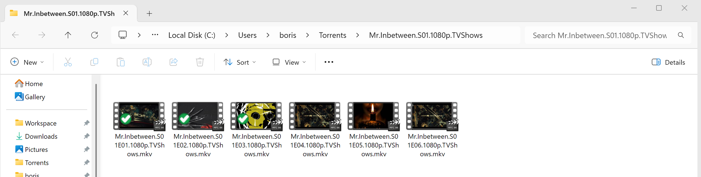

# SeenMark

Windows shell extension that puts a green check badge on files you have **already watched**.
Open an episode in your video player — Explorer marks it instantly, so next time you
open the folder you see exactly what is left to watch.

No renaming, no hidden marker files, no database server: the badge is drawn by a
lightweight icon-overlay handler reading a single local JSON file.



## How it works

Two independent detection channels mark files; one overlay renders them:

| Channel | Latency | Notes |
|---|---|---|
| Process watcher: polls process launches (~400 ms), reads the command line from the PEB, marks every media file passed to a known player | ~1 s | works for MPC-BE/HC, mpv, VLC, PotPlayer, Kodi, ffplay, … (configurable) |
| Windows jump-list scan (`AutomaticDestinations`) every 5 s | minutes | fallback for players not in the list; also seeds your watch history on first run |
| Explorer context menu — *"Mark as watched"* (toggle) | instant | manual override for any file |

Marks are stored in `%LOCALAPPDATA%\seenmark\state.json` (path → watched-at time).
The shell extension (`seenmark.dll`, `IShellIconOverlayIdentifier`) is registered under
**HKCU** — no administrator rights required.

## Build from source

Prerequisites: Windows 10/11 x64, [Rust toolchain](https://rustup.rs) (MSVC), Git.

```
git clone https://github.com/seriousdev-gh/seenmark
cd seenmark
cargo build --release
```

## Install

Run the installer **from the build output folder** (it copies `seen.exe` and
`seenmark.dll` from next to itself):

```
target\release\seen.exe install
taskkill /f /im explorer.exe & start explorer.exe
seen autostart on        # optional: start the watcher at logon
```

HKCU registration only. The badge appears on watched files after the Explorer restart.

## Commands

```
seen install [--machine]      register overlay + menu (HKCU; --machine = HKLM, needs admin)
seen uninstall [--machine]    unregister
seen watch [--verbose]        run the process watcher in foreground
seen watch-stop               kill background watcher instances
seen autostart on|off         run the watcher at logon
seen mark|unmark|toggle <path>
seen list                     list all marked files
seen where                    show data/state/icon/config paths
seen icon                     regenerate the overlay icon
seen dump <pid>               debug: print a process command line
seen extract <file>           debug: extract media paths from a jump-list blob
```

## Configuration

`%LOCALAPPDATA%\seenmark\config.json` (created on first `seen watch`):

```json
{
  "processes":  ["mpc-be64.exe", "mpv.exe", "vlc.exe"],
  "extensions": ["mkv", "mp4", "avi", "mov"],
  "poll_ms":    400
}
```

## Uninstall

```
seen autostart off
seen watch-stop
seen uninstall
taskkill /f /im explorer.exe & start explorer.exe
rmdir /s /q "%LOCALAPPDATA%\seenmark"
```

## Known limitations

- Windows allows only ~11–15 icon overlays system-wide; if all slots are taken
  (OneDrive, TortoiseGit, …) the least-priority handlers lose their badges.
- Explorer caches extracted overlay icons; after `seen icon` restart Explorer.
- Jump-list entries store the path the file had *when it was opened* — files moved
  or copied after watching keep their marks at the old location.
- Files opened inside a player's own "Open" dialog (not via shell launch) are only
  covered by the jump-list channel.
- A manual unmark is final: the jump-list channel never re-adds that file. A
  re-open revives the badge only when the player is launched with the file on its
  command line (player wasn't running yet). A "hot" open via DDE (player already
  running, e.g. MPC-BE) spawns no process and is invisible system-wide — re-mark
  via the context menu or `seen mark`.

## Privacy

Everything runs locally. No network, no telemetry.

## License

MIT — see [LICENSE](LICENSE).
